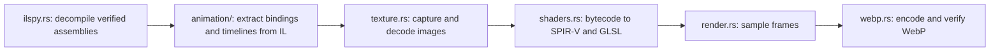

# Development

The minimum supported Rust version is 1.85 for the library and 1.88 for the exporter. Both packages use edition 2024.

The Cargo workspace contains the public `mtgoxml` library at the repository root
and the private `mtgoxml-export` application in `crates/mtgoxml-export`. The
application owns dataset export, browser-site generation, and avatar rendering.
Both packages share the workspace lint policy. The exporter requires Rust 1.88
because image 0.25.10 requires that compiler version. The exporter
depends on the library's `http` and `serde` features; its graphics and codec
dependencies belong to the application package.

```sh
cargo check --locked --workspace --all-targets --all-features
cargo test --locked -p mtgoxml --no-default-features
cargo test --locked --workspace --all-targets --all-features
cargo test --locked --workspace --doc --all-features
cargo fmt --all -- --check
cargo clippy --locked --workspace --all-targets --all-features -- -D warnings
evenflow check . --strict
```

The minimal-feature test selects only the library package so the exporter's
dependency features cannot enable HTTP or serialization during that check.

CI tests the library with Rust 1.85 and the complete workspace with Rust 1.88 and stable on Ubuntu 26.04, macOS, and Windows.
Separate jobs cover minimum compiler support, coverage, documentation, and release tooling. The standalone compiler compatibility job selects the public library.
The Evenflow GitHub Action
must pass before release and the required `Success` check. Renovate tracks the
pinned action and binary versions.

The Ubuntu stable Rust job enables `MTGOXML_TEST_EGL=1` in the existing all-feature
test suite. This requires the actual headless shader test to pass and feeds the
same release and `Success` gates. Other jobs test their selected packages without a graphics runtime.

Keep the Cargo Rust constraint in `renovate.json` aligned with `Cargo.toml`'s
MSRV. Renovate uses it to filter dependency releases and select its Rust toolchain.

## Documentation

The README is the quick start. `docs/usage.md` and `docs/card-data.md` are included
directly in the crate and module Rustdoc; their Rust examples are doctests. Keep
method-specific behavior and errors on the corresponding public items.

```sh
cargo doc --locked --workspace --all-features --no-deps --open
RUSTDOCFLAGS='-D warnings' cargo doc --locked --workspace --all-features --no-deps
RUSTDOCFLAGS='-D warnings' cargo doc --locked -p mtgoxml --no-default-features --no-deps
```

Docs.rs is configured to show all features. New Markdown guides included by
Rustdoc must also be included in the Cargo package.

## Fixtures

Tests use synthetic manifests, a captured deployment, and small derived
CardDataSource samples with provenance. Assertions describe those checked-in
captures rather than the mutable live service. HTTP integration tests use a
local server. Third-party fixture rights remain with their original owners.
Shared fixtures remain in the repository's `fixtures/` directory. Exporter
regressions live with the application in `crates/mtgoxml-export/src/` and read
those fixtures relative to their new package location.

## Website templates

The card browser and avatar gallery HTML live in `templates/index.html` and
`templates/avatars.html`. The exporter embeds and renders them with MiniJinja;
building a site requires no separate template files or template runtime.
Dynamic HTML values are escaped by the template engine. JavaScript and CSS
remain in `web/`.

## Releases

The crate uses the published `clickonce` 0.1 parser. Configure the repository's
`CARGO_REGISTRY_TOKEN` secret before enabling registry publication.

Release tooling requires Node **24.15 or newer**. Run `npm ci && npm test` after
changing it. The regression checks release-note generation and the Cargo
plugin's preparation of manifest and lockfile versions.

The Cargo plugin currently updates private workspace package versions without
updating their entries in the shared lockfile. A prepare-only local hook runs
`cargo update --workspace --offline` immediately afterward to reconcile those
entries while retaining registry dependency versions. The Cargo plugin still
owns version preparation and publication. The regression exercises this sequence
against a workspace fixture, including its private exporter and locked packaging.

The checked-in library version stays `0.0.0`; semantic-release injects release
versions. The workspace defaults to the public library, so Cargo's release
commands select it alone. The exporter has `publish = false` and is not published
to crates.io. Use `--workspace` to check both packages or `-p mtgoxml-export` to
build the exporter explicitly.
Tags use plain SemVer. The initial `0.0.0` tag is a history baseline,
so the first `feat:` after it selects `0.1.0`. Include that tag when pushing the
branch.

Pull requests dry-run release analysis. Publishing runs only on pushes to `main`.

The separate [data-release workflow](data-releases.md) builds the workspace's
`mtgoxml-export` application on a six-hour schedule and publishes its files with
`softprops/action-gh-release`. The executable's regression tests run with the
all-target, all-feature Cargo suite above.

## Avatar rendering

The `mtgoxml-export` package includes native avatar capture, an EGL/OpenGL renderer,
and a lossless animated WebP codec. The exporter requires Rust 1.88. The codec builds
its bundled C sources, so building the exporter requires a target C compiler:

```sh
cargo build --locked --release -p mtgoxml-export
```

Full exports currently run on Linux x86-64. The exporter downloads a pinned native
ILSpy executable automatically, verifies its digest, and uses it to extract client
C# and embedded resources. It translates captured Direct3D shader bytecode with
`vkd3d-compiler` and `spirv-cross`, then renders and encodes WebPs in Rust. Generated
SPIR-V and GLSL are preserved in the data release, rather than checked into Git.
Python and a .NET runtime are unnecessary, and MTGO is never executed.

ILSpy download and extraction code lives in
`crates/mtgoxml-export/src/avatar_assets/ilspy.rs`. Its adjacent `ilspy.toml`
records the tool version, download URL, package entry, and package and executable
checksums. The exporter embeds this configuration and records those settings in
the capture provenance.

Native export jobs use Ubuntu 26.04 and cache a compiler built from the verified
vkd3d 2.1 source archive. The ordinary Rust test matrix needs no shader translation
tools. To set up a local Ubuntu export environment:

```sh
sudo apt-get install --no-install-recommends -y build-essential pkg-config flex bison libjson-perl libvulkan-dev spirv-headers spirv-cross libegl1 libgl1-mesa-dri
bash scripts/install-avatar-shader-tools.sh /tmp/mtgoxml-shader-tools
export PATH="/tmp/mtgoxml-shader-tools/bin:$PATH"
```

The exporter normally finds both translators on `PATH`. `MTGOXML_VKD3D_COMPILER`
and `MTGOXML_SPIRV_CROSS` can point to specific executables. Each capture records
the tools and commands used for conversion.

On Ubuntu, install Mesa's EGL runtime and software driver, then enable the strict
graphics regression locally:

```sh
sudo apt-get install --no-install-recommends -y libegl1 libgl1-mesa-dri
MTGOXML_TEST_EGL=1 cargo test --locked --workspace --all-targets --all-features
```

The renderer obtains a surfaceless EGL display and a small pbuffer; it needs no
desktop session. An unavailable EGL context fails the strict graphics test.
The ordinary suite still tests timing and lossless WebP round trips without EGL.

Each export uses resources from its captured application manifest and verifies
their declared sizes and digests. The renderer's bindings and animation data come from
structured metadata and IL extraction of those assemblies. Unsupported client
behavior remains captured with an extraction diagnostic; unavailable avatar images
remain `missing`. Decoded pixels and playback durations are verified before a
render is complete. See the
[avatar release format](data-releases.md#animated-avatars-schema-version-1)
for index statuses, archive contents, and preview timing.

### Export flow

`avatar_assets/mod.rs` coordinates these stages:



The archive retains the captured client code, textures, shader programs, and
provenance. Exporter source and workspace files remain in the repository.

`Texture` keeps each image's archive path and local path together. Its `capture`
method downloads and validates the source before saving it; `decode` loads the
saved image with the same PNG/JPEG and allocation limits for rendering.

### Structured effect extraction

The `animation` module reads the captured `ShaderEffects.dll`, `Core.dll`, and
`WotC.MtGO.Client.Model.Core.dll` directly with `cildec`. Its IL reader retains
typed opcodes, signatures, literal values, and branch targets. The assemblies are
data inputs; extraction uses Rust recognizers for supported operations and does
not execute client code.

Binding extraction follows the client's catalog-effect conversion, avatar control
assignments, dependency-property registrations, constructors, and property-change
callbacks. This supplies the shader resource, sampler sources, constant registers,
and defaults, including avatar-specific overrides. The renderer reflects the
linked GLSL uniform interface, so unused inherited properties do not determine
the shader's register count.

Constant packing follows WPF: a scalar replaces a complete register with
`[value, 1, 1, 1]`, while a virtual-pointer component track preserves the other
coordinates of its vector register.

Animation extraction follows startup methods and recognizes keyframes, linear
ranges, easing, repeat, reverse, and acceleration/deceleration settings. Each
track targets its extracted property/register binding. Where the client starts
mouse animation, previews use a standard twelve-second virtual-pointer loop.
Client stop tracks supply the paused time value for effects whose hover handler
stops time. Random phases and delays are fixed at zero. One-shot tracks hold their
last value and retrigger when the preview repeats; combined periods are bounded
at two minutes.

This is a bounded recognizer for client patterns, rather than a complete CLR or
WPF implementation. Unsupported instructions, calls, or animation shapes produce
an `unsupported` row with `reason: "unsupported_effect_behavior"` and an extraction
diagnostic. Supporting a new pattern requires implementing and checking its
semantics, without adding a per-client or per-image hash allowlist.

Texture and shader hashes record the actual inputs and generated outputs in the
archive. Changed pixels or shader bytes can render automatically when their
bindings and animation patterns are supported.

To check extraction against a previously captured bundle, use its `original/`,
`decompiled/`, `textures/`, and `avatars.json` files:

```sh
MTGOXML_TEST_AVATAR_BUNDLE=/path/to/bundle cargo test --locked -p mtgoxml-export captured_effects_drive_verified_native_previews -- --nocapture
```

With the shader tools on `PATH`, also set `MTGOXML_TEST_EGL=1` to render a
representative available avatar for each extracted effect and verify the WebP
pixels and playback duration. The ordinary tests use small, self-authored metadata
and IL fixtures for extraction and interpolation behavior.
